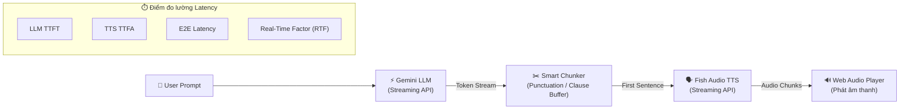

# 🎙️ Voice Pipeline Benchmark: Gemini LLM + Fish Audio TTS

Dự án tích hợp **Gemini LLM** và **Fish Audio Cloud API (TTS)** để đo lường các chỉ số hiệu năng thời gian thực (**Latency, TTFT, TTFA, E2E Latency, RTF**) và kiểm thử năng lực tạo giọng nói cảm xúc (**Emotion Voice**) của Fish Audio.

---

## 🌟 Tính năng chính

1. **Giao diện Web Trực quan (Interactive Web UI):**
   - Trực tiếp nhập câu hỏi (hỗ trợ song ngữ Tiếng Việt & Tiếng Anh).
   - Nghe âm thanh giọng nói trả lời tức thì trên trình phát audio.
   - Bảng Dashboard đo lường metrics theo thời gian thực (real-time).
   - Preset thử nghiệm cảm xúc nhanh: *Bình thường, Hào hứng, Buồn bã, Tức giận, Thì thầm, Kịch tính*.
   - Tùy biến linh hoạt mô hình Gemini (`gemini-2.5-flash`, `gemini-1.5-flash`, `gemini-1.5-pro` hoặc bất kỳ model nào).
   - Tùy chọn Fish Audio Voice ID (để trống để dùng giọng mặc định).
   - Lưu trữ và so sánh lịch sử các lượt chạy.

2. **Hệ thống Đo lường Chỉ số (Benchmark Metrics):**
   - **⚡ LLM TTFT (Time To First Token):** Thời gian Gemini trả về token đầu tiên.
   - **✂️ First Clause/Sentence Latency:** Thời gian bộ đệm Chunker gom đủ câu đầu tiên để chuyển sang TTS.
   - **🗣️ TTS TTFA (Time To First Audio Chunk):** Thời gian Fish Audio sinh và trả về byte âm thanh đầu tiên.
   - **🚀 E2E Latency (Prompt -> First Sound):** Tổng thời gian từ lúc người dùng gửi câu hỏi đến khi nghe thấy âm thanh đầu tiên phát ra.
   - **⏱️ Audio Duration:** Độ dài file âm thanh đã sinh (tính bằng giây).
   - **📈 RTF (Real-Time Factor):** `TTS Generation Time / Audio Duration`. (Giá trị < 1.0 đảm bảo tốc độ nhanh hơn thời gian thực).

3. **Kiểm thử Năng lực Biểu cảm (Emotion Voice Evaluation):**
   - Đánh giá khả năng điều phối ngữ điệu (prosody), cảm xúc theo ngữ cảnh của Fish Audio.
   - Bộ kịch bản prompt phong phú tại `emotion_tests/emotion_scenarios.json`.

---

## 🏗️ Kiến trúc Pipeline



---

## 📁 Cấu trúc Thư mục

```text
Fish_Audio_Testing/
├── README.md                      # Hướng dẫn chi tiết & kế hoạch
├── requirements.txt               # Thư viện phụ thuộc
├── .env.example                   # Mẫu cấu hình API keys
├── .env                           # File API keys thực tế (tạo từ .env.example)
├── config.py                      # Cấu hình tham số môi trường
├── app.py                         # FastAPI Web Server & REST API
├── templates/
│   └── index.html                 # Giao diện web tương tác trực tiếp
├── src/
│   ├── llm/
│   │   └── gemini_client.py       # Client Gemini (hỗ trợ streaming & TTFT)
│   ├── tts/
│   │   └── fish_audio_client.py   # Client Fish Audio Cloud API (hỗ trợ streaming & TTFA)
│   ├── pipeline/
│   │   ├── chunker.py             # Bộ tách câu/mệnh đề thông minh
│   │   └── voice_pipeline.py      # Bộ điều phối Pipeline E2E & ghi nhận metrics
│   └── utils/
│       └── audio_utils.py         # Đo độ dài MP3 và tính toán RTF
├── benchmarks/
│   └── prompts_latency.json       # Danh sách prompt benchmark ngắn/vừa/dài
├── emotion_tests/
│   └── emotion_scenarios.json     # Kịch bản prompt kiểm thử biểu cảm giọng nói
└── outputs/
    ├── audio_samples/             # Thư mục chứa các file MP3 được sinh ra
    └── benchmarks/                # Kết quả báo cáo thống kê
```

---

## 🚀 Hướng dẫn Cài đặt & Khởi chạy

### Bước 1: Kích hoạt môi trường ảo Python
Môi trường ảo đã được chuẩn bị sẵn tại thư mục `venv`:
```bash
source venv/bin/activate
```
*(Nếu cần cài lại dependencies: `uv pip install -r requirements.txt`)*

### Bước 2: Thiết lập API Keys trong `.env`
Sao chép `.env.example` thành `.env`:
```bash
cp .env.example .env
```
Mở file `.env` và điền hai khóa API:
```env
# Google Gemini API Key
GEMINI_API_KEY="AIzaSy..."

# Fish Audio API Key
FISH_AUDIO_API_KEY="sk-fish-..."

# Default Gemini Model (siêu nhanh)
DEFAULT_GEMINI_MODEL="gemini-3.1-flash-lite"

# Fish Audio Voices:
# - Phi Hùng (Nam Tiếng Việt biểu cảm): d6126bec5abc465fb965335e043aafbb
# - Nữ VN (Truyền cảm, rõ ràng): 4348ff4c4ce043d58866790fdc670400
# - Sarah (Nữ Tiếng Anh tự nhiên): 933563129e564b19a115bedd57b7406a
DEFAULT_FISH_VOICE_ID="d6126bec5abc465fb965335e043aafbb"
```

### Bước 3: Khởi động Web Giao diện
Chạy lệnh:
```bash
python3 app.py
```
Giao diện sẽ chạy tại: **`http://localhost:7860`** (hoặc port mạng cục bộ của máy bạn).

---

## 🧪 Hướng dẫn Sử dụng Giao diện Web

1. **Gõ câu hỏi hoặc bấm câu mẫu:** Có sẵn các câu mẫu bằng Tiếng Việt và Tiếng Anh.
2. **Chọn Cảm xúc:** Bấm các nút preset như *Hào hứng, Buồn bã, Tức giận, Thì thầm, Kịch tính* để kiểm tra giọng đọc biểu cảm của Fish Audio.
3. **Chọn mô hình Gemini:** Mặc định là `gemini-2.5-flash` (đáp ứng cực nhanh). Bạn có thể đổi sang `gemini-1.5-flash`, `gemini-1.5-pro` tùy ý.
4. **Bấm "Chạy Pipeline & Nghe Thử":**
   - Xem Gemini sinh phản hồi.
   - Trình duyệt sẽ phát âm thanh trả lời ngay khi sẵn sàng.
   - Các thẻ chỉ số (TTFT, TTFA, E2E Latency, Duration, RTF) sẽ được cập nhật chi tiết.
   - Lịch sử các lần chạy được lưu ở bảng dưới cùng để bạn so sánh giữa các model và loại cảm xúc.
